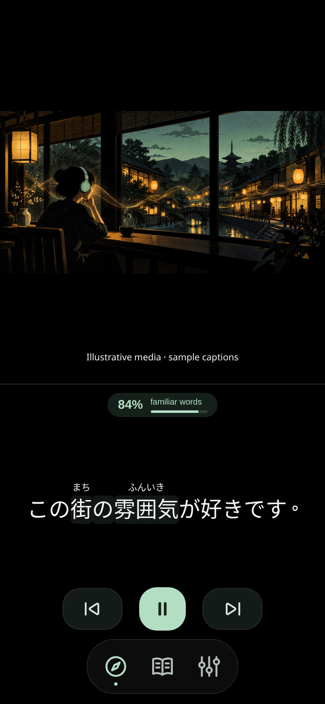
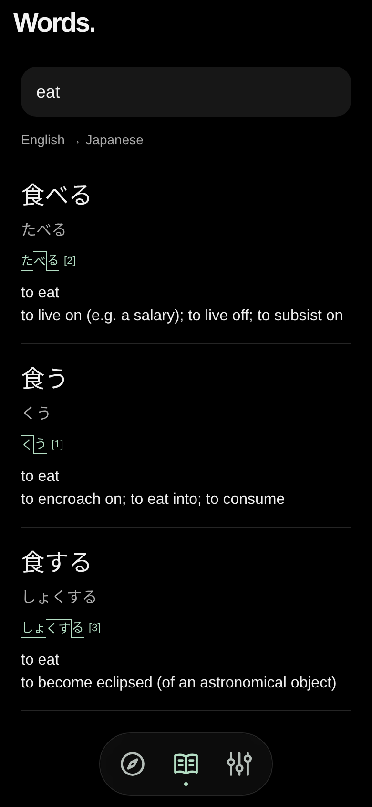
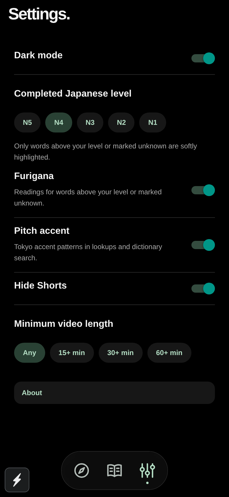
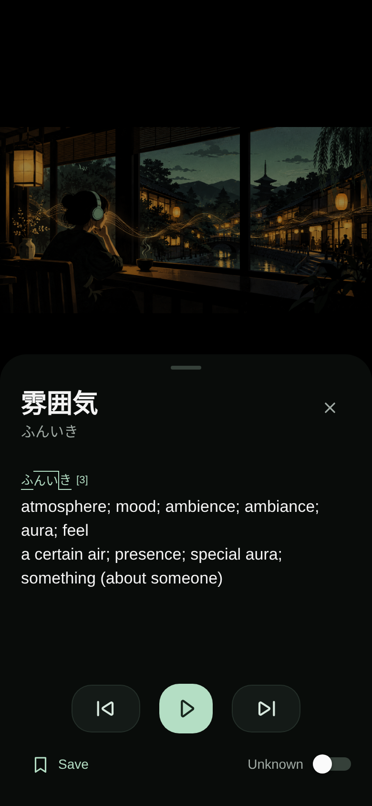
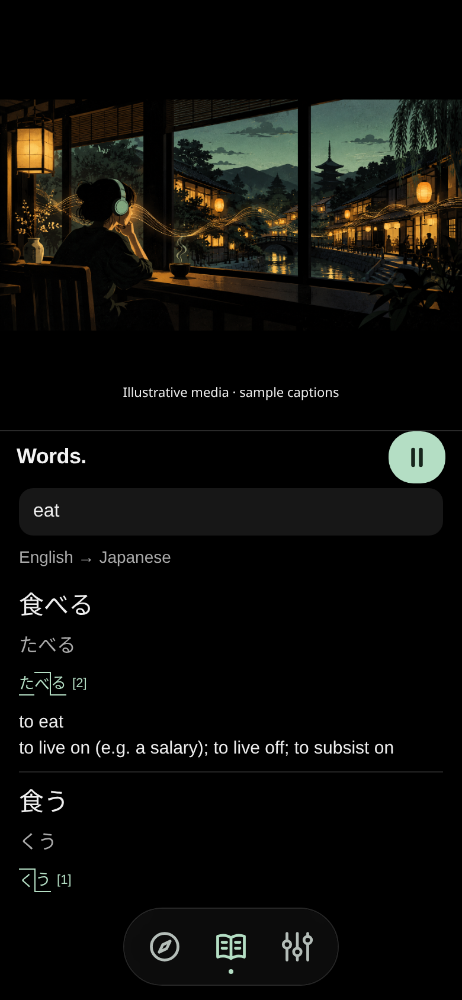
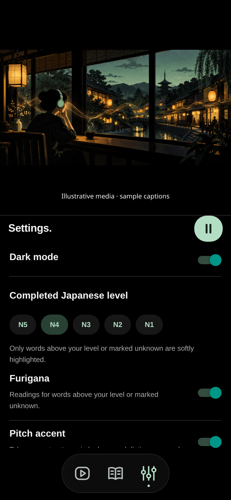

<p align="center"></p>
<h1 align="center">Immersed</h1>
<p align="center"><strong>Japanese worth watching.</strong><br />Watch a video. Tap a word. Keep your flow.</p>
<p align="center">iPhone-first · Japanese immersion · Early Expo Go prototype</p>
<p align="center">
  <a href="https://github.com/Somamill/immersed/releases/latest">Download source</a> ·
  <a href="#try-it-on-your-iphone">Try on iPhone</a> ·
  <a href="CHANGELOG.md">What's new</a> ·
  <a href="docs/SUBTITLE_QUALITY.md">Subtitle quality</a>
</p>


**Learn from content you would watch anyway.** Immersed puts a focused video above a quiet Japanese reading area. Tap a word or grammar group for its meaning, save it with context, and keep watching.

> **Prototype status:** source-caption study, dictionary search and saved vocabulary are implemented. Creating fresh subtitles for captionless YouTube videos is **not working in the current cloud preview** because it cannot acquire the audio. Recognition can also choose incorrect words or kanji. This is not yet a reliable universal transcription service or an App Store release.

## A small interface for a bigger world

<table>
  <tr>
    <td align="center"></td>
    <td align="center"></td>
    <td align="center"></td>
  </tr>
  <tr>
    <td align="center"><strong>Stay with the sentence</strong><br />Tappable words. Quiet reading space.</td>
    <td align="center"><strong>Find the right word</strong><br />English ↔ Japanese. Vocabulary in context.</td>
    <td align="center"><strong>Make it yours</strong><br />Your level, your readings, your theme.</td>
  </tr>
</table>

<p align="center"><br /><strong>Meanings and controls within reach.</strong></p>

<p align="center"> </p>

*Screenshots show the actual app UI rendered in a browser at phone dimensions. The study and inline-panel images use clearly labelled illustrative media and sample captions; vocabulary estimates in them are computed from that sample; it is not a live YouTube/iPhone transcription demonstration. The banner is original generated artwork.*

## Built around immersion

- **Natural content:** browse ordinary Japanese daily life, food, travel, science, gaming and conversation. Discovery is language-biased search, not a verified Japanese-only feed.
- **Check confusing phrases:** a compact Japanese context model can choose a close-sounding alternative already proposed by a recognizer. Morphology guards protect proper/unknown words, numbers and negation; this is language plausibility, not verified speech.
- **Compare generated captions:** ReazonSpeech, Whisper Small and Kotoba Whisper evaluate the same audio chunks progressively. The worker keeps candidate phrases, disagreement and timings; the current CPU preview cannot deliver guaranteed real-time three-model recognition. Settings → About contains the latest comparison report. Source-audio access is still blocked in this preview.
- **Resolve caption mix-ups:** word lookups explain grammatical endings and can suggest a same-reading spelling from sentence context. For example, 事象 may fit a caption misheard as 自称. Suggestions do not rewrite source captions automatically.
- **Tap to understand:** automatic word/grammar grouping, dictionary forms and readings. Tapping a subtitle opens the word popup, pauses playing video, and resumes on dismissal. Save and a bottom-right known/unknown switch stay within reach. Dictionary search is a separate panel that leaves playback running.
- **Your level, less clutter:** choose a completed JLPT level. Text stays white in dark mode; unfamiliar words have a soft highlight. Light mode uses dark text for readability. Optional furigana appears on harder kanji words. Known/unknown choices override estimates.
- **Optional pitch accents:** enable Settings → Pitch accent to see recorded Tokyo accent patterns in word lookups and Dictionary search, using Kanjium data. Patterns refer to dictionary forms; sentence pronunciation and inflections can differ.
- **One place for words:** search English or Japanese and keep vocabulary with its original caption/video context. Uses the full JMdict English dataset plus JMnedict name readings and name categories; no paid dictionary subscription or manual import.
- **A focused view:** a complete video frame with black bars, pinch-out to fill/pinch-in to fit, a fixed subtitle area, a compact glass navigation pill, light/dark themes and optional Shorts hiding. Selected videos use the dedicated embed instead of a watch page with comments.
- **Move naturally:** swipe the glass dock left/right between content, Words and Settings. Use previous/play-pause/next controls to revisit caption boundaries, or swipe the reading area to seek 10 seconds; swipe down on the dictionary header to close it. Swipe from the left edge to return to the previous panel or leave the selected video. These are app gestures; a full native interactive stack transition is not implemented.
- **Choose your session length:** Settings → Minimum video length offers Any, 15+, 30+ or 60+ minutes. Recognized loaded YouTube cards are filtered by their visible duration; live/unknown-duration cards are hidden with a minimum enabled. This does not search or verify the entire catalog.
- **Stay with the video:** Dictionary and Settings use the lower reading area while a video is selected, with playback left running. Without a selected video they open full screen.
- **Gauge the vocabulary:** a caption-sample estimate shows the share of familiar content words for your JLPT level and personal overrides. One percentage counts familiar words over all sampled content vocabulary, with unrated words not assumed known; this is not a listening-comprehension score.
- **Keep useful captions:** verified Japanese tracks are cached on the device for repeat visits. Creator-provided tracks take priority over automatic tracks. Caption caches do not make videos or the server dictionary available offline.

## Try it on your iPhone

Install **Expo Go** on your iPhone. Using Node.js 24, from a clone of this repository:

```sh
npm ci
npm run language:setup
npx expo start --tunnel --go
```

Open the printed link/QR code in Expo Go. The development server supplies dictionary/analysis and must stay running. No Apple Developer subscription is needed for this preview; Expo Go keeps its own installed Home Screen icon. Preview links are temporary and can stop when their server/workspace stops.

For the optional self-hosted recognition worker, setup details and platform limits, see the [development guide](docs/DEVELOPMENT.md). A static web export or signed app does not include a running backend. Videos that prohibit embedding or require inaccessible account/region permissions may not play. YouTube account sign-in is unavailable in this preview; unsupported sign-in links show an explanation instead of redirecting to Safari. Native OAuth would require a registered client and would not itself establish an authenticated embedded-player session. Locked-screen audio is not supported in this preview.

## Accuracy comes before appearance

Japanese has homophones and multiple valid spellings. A neat subtitle can still be wrong. Immersed preserves the source's kanji/kana choices rather than inventing corrections from dictionary readings.

The current quality work prioritizes better source tracks, correct rolling-caption timing, compact Japanese rows and dictionary-backed joins where words cross adjacent cues. Prefix compounds such as お名前 and 再利用 keep their full lookup form. Dictionary-backed expressions such as 気を抜く also stay together across supported inflections. The next recognition milestone is a stronger Japanese model evaluated against real recordings, followed by audio alignment. That work needs permitted audio access and persistent hosting. Read the [quality findings](docs/SUBTITLE_QUALITY.md) and [reliability release gates](RELIABILITY.md).

## Build with us

The goal is simple: **tap a Japanese video and learn from it**. The prototype is still being built toward that goal. Reproducible bug reports, physical-iPhone testing and careful Japanese transcript review are welcome.

- [Latest release and source downloads](https://github.com/Somamill/immersed/releases/latest)
- [Report an issue](https://github.com/Somamill/immersed/issues/new)
- [Development, checks and architecture](docs/DEVELOPMENT.md)
- [Research and implementation notes](RESEARCH.md)
- [Version history](CHANGELOG.md)
- [Dictionary/data credits and licenses](THIRD_PARTY.md)

Saved vocabulary and caption caches stay on the device; subtitle analysis and dictionary searches use the preview server. JMdict © EDRDG, CC BY-SA 4.0. JLPT estimates, Kuromoji and IPADIC notices are linked in the credits. JLPT levels and grammar groups are estimates, not official classifications or complete grammatical explanations.
