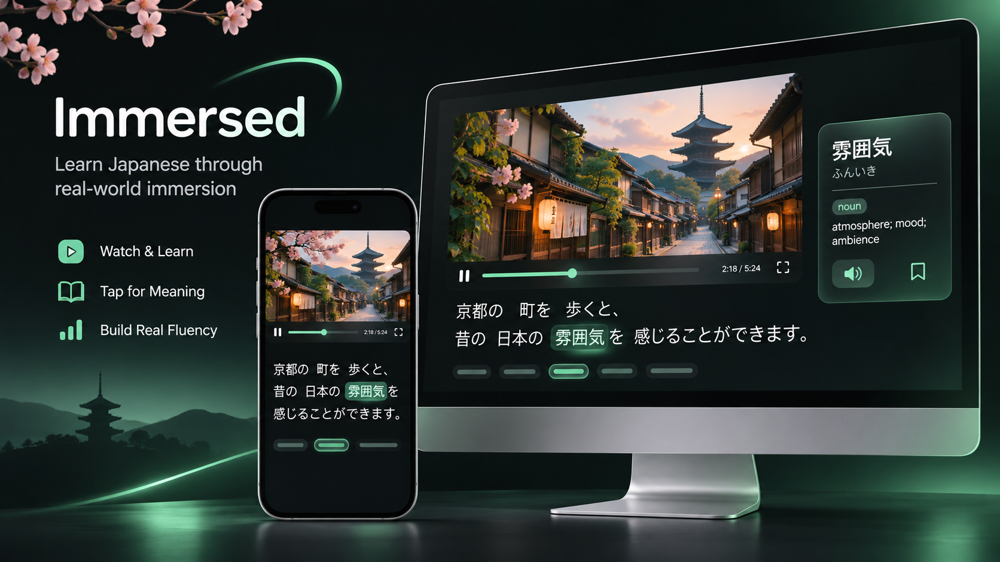
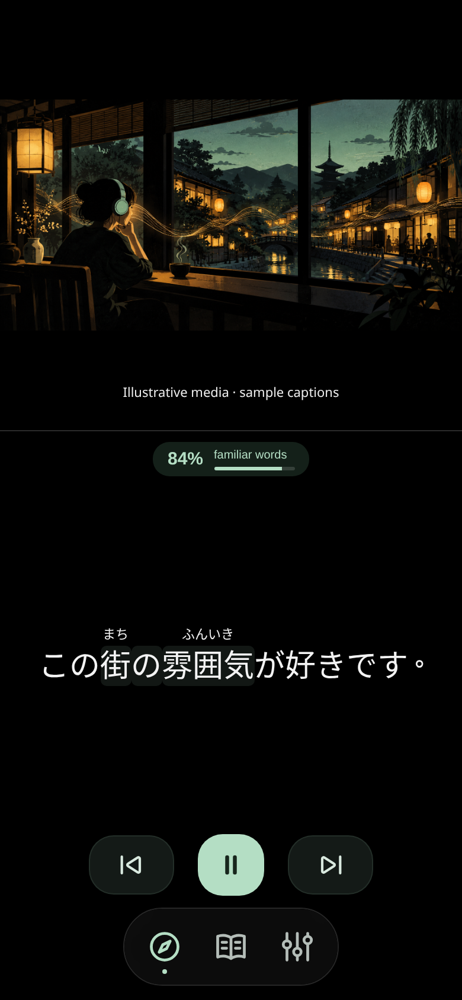
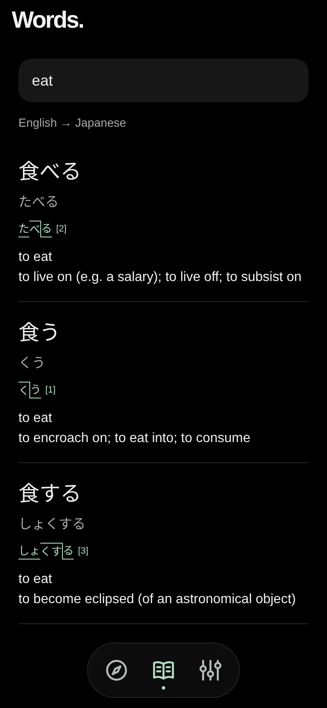
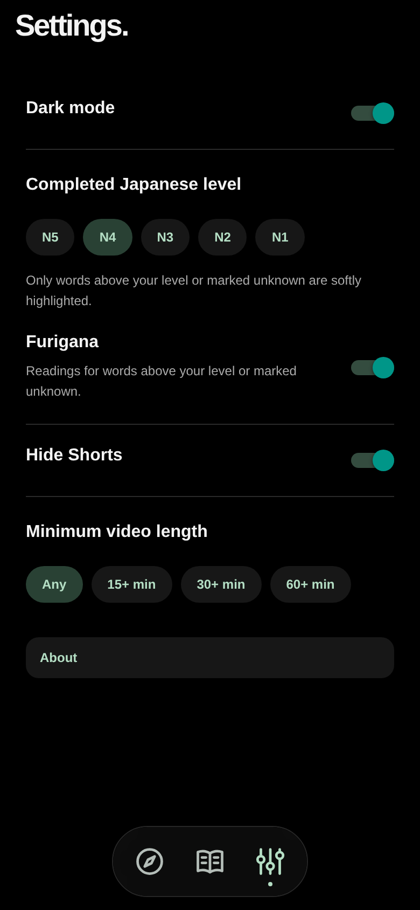
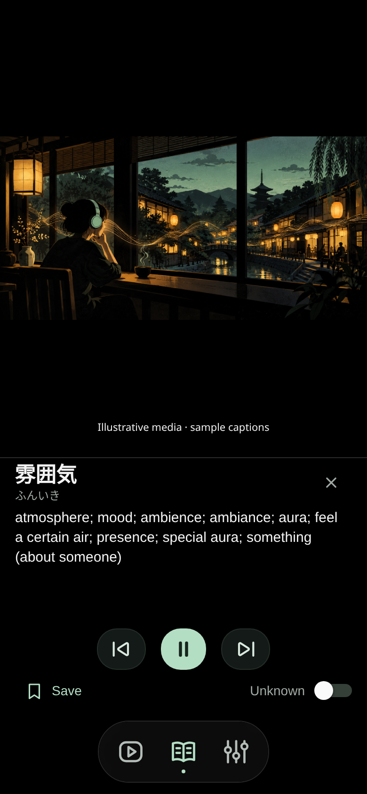
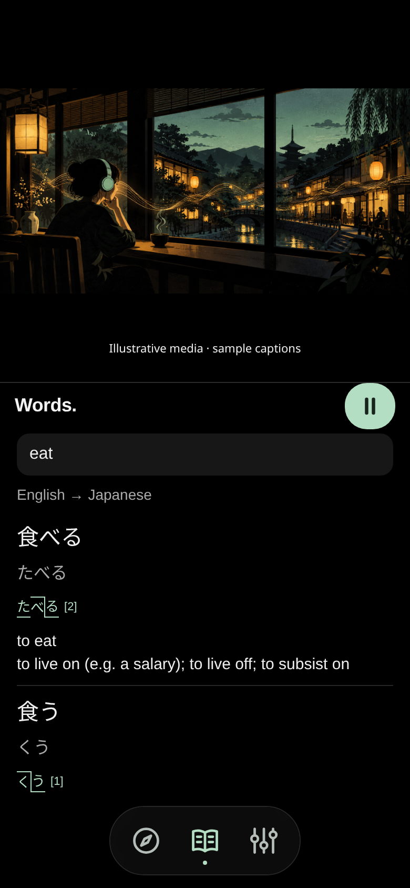
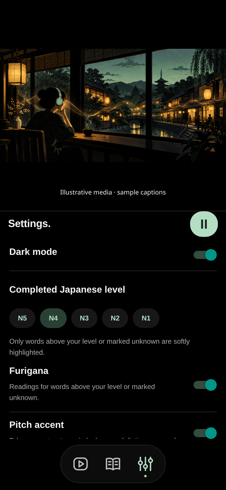

<h1 align="center">Immersed · Japanese immersion for iPhone and Mac</h1>

<strong>Japanese worth watching.</strong> Watch a video. Tap a word. Keep your flow.

Free, open-source language learning with YouTube subtitles, tap-to-lookup dictionaries and vocabulary in context.

  
  
  
  
  

  <a href="https://github.com/Somamill/immersed/releases/latest">Download source</a> ·
  <a href="#try-it-on-your-iphone">Try on iPhone</a> ·
  <a href="docs/MACOS.md">Try on Mac</a> ·
  <a href="CHANGELOG.md">What's new</a> ·
  <a href="docs/SUBTITLE_QUALITY.md">Subtitle quality</a> ·
  <a href="docs/SUBTITLE_AUDIT.md">Latest audit</a>

*Original AI-generated concept art; device screens illustrate the product goal and are not screenshots of a live transcription.*

**Turn the Japanese you already enjoy into daily practice.** Watch real conversations, gaming, travel or science on YouTube. Tap a subtitle word, understand the grammar, save it with its sentence, and keep your flow.

Built for learners looking for a **free, open-source immersion tool for iPhone and macOS**, with inspectable dictionary and subtitle tools. This is an independent early project; it does not claim feature parity with Migaku or Language Reactor.

> **Prototype status:** The iPhone preview supports source-caption study, dictionary search and saved vocabulary. Fresh subtitles for captionless YouTube videos are **not working in that cloud preview** because it cannot acquire the audio. The Mac test downloads accessible video audio locally and begins showing generated subtitles after its first 60-second recognition chunk. Neither platform guarantees every video or perfect Japanese recognition; the Mac install has not yet been tested on physical macOS hardware.

## A small interface for a bigger world

<table>
  <tr>
    <td align="center"></td>
    <td align="center"></td>
    <td align="center"></td>
  </tr>
  <tr>
    <td align="center"><strong>Stay with the sentence</strong> Tappable words. Quiet reading space.</td>
    <td align="center"><strong>Find the right word</strong> English ↔ Japanese. Vocabulary in context.</td>
    <td align="center"><strong>Make it yours</strong> Your level, your readings, your theme.</td>
  </tr>
</table>

 <strong>Meanings and controls within reach.</strong>

 

*Screenshots show the actual iPhone app UI rendered in a browser at phone dimensions. The study and inline-panel images use illustrative media and sample captions; they are not a live YouTube/iPhone transcription demonstration.*

## Watch → tap → understand

| While you watch | While you learn |
| --- | --- |
| Portrait video with a steady reading area | Tap Japanese words and grammar groups |
| Previous sentence, play/pause, next sentence | Japanese ↔ English search with JMdict and JMnedict |
| Pinch to fit/fill; optional Shorts and length filters | Save vocabulary with its original sentence and video |
| Dictionary and Settings below the same video | JLPT N5–N1 highlights, furigana and optional pitch accent |

**General context checks, without a paid AI API.** A local SQLite database counts Japanese word pairs and triples from 235,085 Tatoeba sentences. Pronunciation, grammar, evidence on both sides and ranking margins help filter alternatives. Sparse cases can receive a second check from a small local model. Generated audio candidates also face recognizer agreement and context checks. Frequency and agreement are evidence, not proof of what was said.

<strong>Explore all features and current boundaries</strong>

- **Natural content:** browse ordinary Japanese daily life, food, travel, science, gaming and conversation. Discovery is language-biased search, not a verified Japanese-only feed.
- **Check confusing phrases:** a compact Japanese context model can choose a close-sounding alternative already proposed by a recognizer. Morphology guards protect proper/unknown words, numbers and negation; this is language plausibility, not verified speech.
- **Compare generated captions:** ReazonSpeech, Whisper Small and Kotoba Whisper evaluate the same audio chunks progressively. The worker keeps candidate phrases, disagreement and timings; the current CPU preview cannot deliver guaranteed real-time three-model recognition. Settings → About contains the latest comparison report. Source-audio access is still blocked in this preview.
- **Try local captions on iPhone:** a native-build prototype uses ReplayKit's app-audio samples and Apple's on-device Japanese Speech framework when YouTube has no Japanese track. iOS asks for recording and speech permission. A community native iPhone build, real-device testing and third-party authorization are required before calling this supported; this capture feature is excluded from the Store edition. Protected media and unavailable Japanese recognition remain limitations.
- **Resolve caption mix-ups:** word lookups explain grammatical endings and can suggest a same-reading spelling from sentence context. For example, 事象 may fit a caption misheard as 自称. Suggestions do not rewrite source captions automatically.
- **Tap to understand:** automatic word/grammar grouping, dictionary forms and readings. Tapping a subtitle opens the word popup, pauses playing video, and resumes on dismissal. Save and a bottom-right known/unknown switch stay within reach. Dictionary search is a separate panel that leaves playback running.
- **Your level, less clutter:** choose a completed JLPT level. Text stays white in dark mode; unfamiliar words have a soft highlight. Light mode uses dark text for readability. Optional furigana appears on harder kanji words. Known/unknown choices override estimates.
- **Optional pitch accents:** enable Settings → Pitch accent to see recorded Tokyo accent patterns in word lookups and Dictionary search, using Kanjium data. Patterns refer to dictionary forms; sentence pronunciation and inflections can differ.
- **One place for words:** search English or Japanese and keep vocabulary with its original caption/video context. Uses the full JMdict English dataset plus JMnedict name readings and name categories; no paid dictionary subscription or manual import.
- **A focused view:** the YouTube mobile watch player or an HTTPS iframe fallback appears above a fixed subtitle area, with a compact glass navigation pill, light/dark themes and optional Shorts hiding. YouTube still controls whether a video can play inside another app.
- **Move naturally:** swipe the glass dock left/right between content, Words and Settings. Use previous/play-pause/next controls to revisit caption boundaries, or swipe the reading area to seek 10 seconds; swipe down on the dictionary header to close it. Swipe from the left edge to return to the previous panel or leave the selected video. These are app gestures; a full native interactive stack transition is not implemented.
- **Choose your session length:** Settings → Minimum video length offers Any, 15+, 30+ or 60+ minutes. Recognized loaded YouTube cards are filtered by their visible duration; live/unknown-duration cards are hidden with a minimum enabled. This does not search or verify the entire catalog.
- **Stay with the video:** Dictionary and Settings use the lower reading area while a video is selected, with playback left running. Without a selected video they open full screen.
- **Gauge the vocabulary:** a caption-sample estimate shows the share of familiar content words for your JLPT level and personal overrides. One percentage counts familiar words over all sampled content vocabulary, with unrated words not assumed known; this is not a listening-comprehension score.
- **Keep useful captions:** verified Japanese tracks are cached on the device for repeat visits. Creator-provided tracks take priority over automatic tracks. Caption caches do not make videos or the server dictionary available offline.

## App Store preparation

The standalone Store edition has an App Store Connect record. Its scope, privacy policy and release gates are in [App Store preparation](docs/APP_STORE.md). Native builds use Xcode and TestFlight; this edition does not require a hosted language service. Public release remains subject to acceptance tests and Apple review.

## Persistent hosting

The optional community HTTPS backend can serve the language API from one stable origin. The Store edition uses a bundled dictionary and does not require that backend. The Docker/Compose setup includes persistent caches and HTTPS. **It has not been deployed to a permanent host.** See [deployment instructions and acceptance checks](docs/DEPLOYMENT.md).

The optional acoustic alignment pass uses real audio to place selected words; it cannot fix incorrect text. Larger recognizers tested in this update did not beat the baseline. See [measured results and remaining limits](docs/RECOGNITION_UPGRADE.md).

## Try the Mac transcription draft

The Apple Silicon Mac app **immersed.** opens its own window with embedded YouTube, a local video/audiobook library, offline study, hover lookup, shared iOS learning settings and local MLX speech recognition. It imports MP4 and Japanese M4B/M4A/MP3 media, supports chapters and keyboard controls, and includes filtered YouTube search and accessible-video downloads. See [Mac installation, features and limits](docs/MACOS.md) and [validation](docs/MACOS-VALIDATION.md). Google embedded sign-in and automatic cross-device iCloud synchronization remain unresolved/deferred.

## Try it on your iPhone

The Store edition in `Apps/Store` is a standalone native app for importing videos you own and Japanese subtitles, offline word lookup and saved vocabulary. Build and sign it with Xcode, then distribute through TestFlight and the App Store; see [native delivery instructions](TESTFLIGHT.md). Public App Store availability remains subject to Apple review.

Expo/EAS cloud builds, hosted JavaScript updates and Expo Go previews are retired. Native SDK modules and local project generation remain development dependencies. The separately distributed community edition retains its experimental integrations and their documented limitations; those features are not shipped in the Store edition.

## Coming from Migaku, Language Reactor or Yomitan?

These projects share an immersion-learning idea; their platforms and scope differ.

| Project | Explore it for |
| --- | --- |
| **Immersed** | An open-source iPhone and Mac experiment combining video, Japanese dictionary lookup and saved vocabulary. Native Store edition and a separate community Mac edition. |
| [Migaku](https://migaku.com/) | An established commercial immersion ecosystem and browser workflow. |
| [Language Reactor](https://www.languagereactor.com/) | A browser-based language-learning companion. |
| [asbplayer](https://docs.asbplayer.dev/) | Free, open-source browser video study and subtitle sentence mining. |
| [Yomitan](https://yomitan.wiki/) | Free browser dictionary lookups, frequency information and Anki integration. |

Immersed is not affiliated with these projects. Their names explain the learning workflow, and no proprietary code or dictionaries are included. Anki export, podcast playback, universal caption generation and App Store distribution are still roadmap items.

## Accuracy comes before appearance

Japanese has homophones and multiple valid spellings. A neat subtitle can still be wrong. Immersed preserves the source's kanji/kana choices rather than inventing corrections from dictionary readings.

The current quality work prioritizes better source tracks, correct rolling-caption timing, compact Japanese rows and dictionary-backed joins where words cross adjacent cues. Prefix compounds such as お名前 and 再利用 keep their full lookup form. Dictionary-backed expressions such as 気を抜く also stay together across supported inflections. Three open recognizers and local context checks are implemented. The next milestone is representative conversation evaluation and better audio alignment. That work needs permitted audio access and persistent hosting. Read the [quality findings](docs/SUBTITLE_QUALITY.md) and [reliability release gates](RELIABILITY.md).

## Roadmap

- [x] Japanese video study, dictionaries, saved words and learning-level controls.
- [x] ReazonSpeech / Whisper / Kotoba comparison worker and corpus-based sequence checks.
- [ ] Reliable permitted audio acquisition and persistent transcription hosting.
- [ ] Broader natural-conversation benchmarks, speaker overlap and accurate word alignment.
- [ ] Anki export, podcasts, additional languages and a standalone iOS release.

## Build with us

The goal is simple: **tap a Japanese video and learn from it**. The prototype is still being built toward that goal. Reproducible bug reports, physical-iPhone testing and careful Japanese transcript review are welcome.

- [Latest release and source downloads](https://github.com/Somamill/immersed/releases/latest)
- [Report a bug or subtitle error](https://github.com/Somamill/immersed/issues/new/choose)
- [Contribute code, language review or iPhone testing](CONTRIBUTING.md)
- [Development, checks and architecture](docs/DEVELOPMENT.md)
- [Research and implementation notes](RESEARCH.md)
- [Repository description and topic tags](docs/REPOSITORY.md)
- [Version history](CHANGELOG.md)
- [Dictionary/data credits and licenses](THIRD_PARTY.md)

Saved vocabulary and caption caches stay on the device; subtitle analysis and dictionary searches use the preview server. JMdict © EDRDG, CC BY-SA 4.0. JLPT estimates, Kuromoji and IPADIC notices are linked in the credits. JLPT levels and grammar groups are estimates, not official classifications or complete grammatical explanations.

Code is [MIT licensed](LICENSE). Dictionary and corpus data have separate [licenses and contributor credits](THIRD_PARTY.md). Self-hosted speech processing consumes compute even though no paid model API is required.
